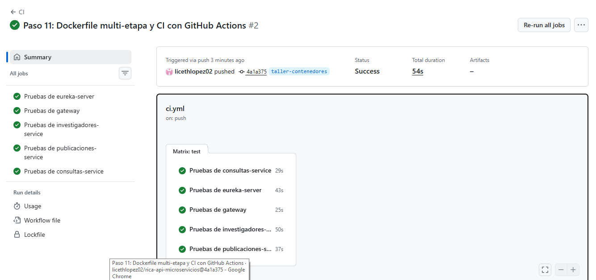
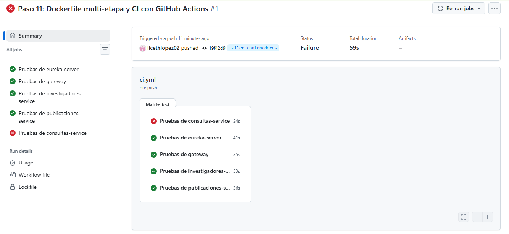
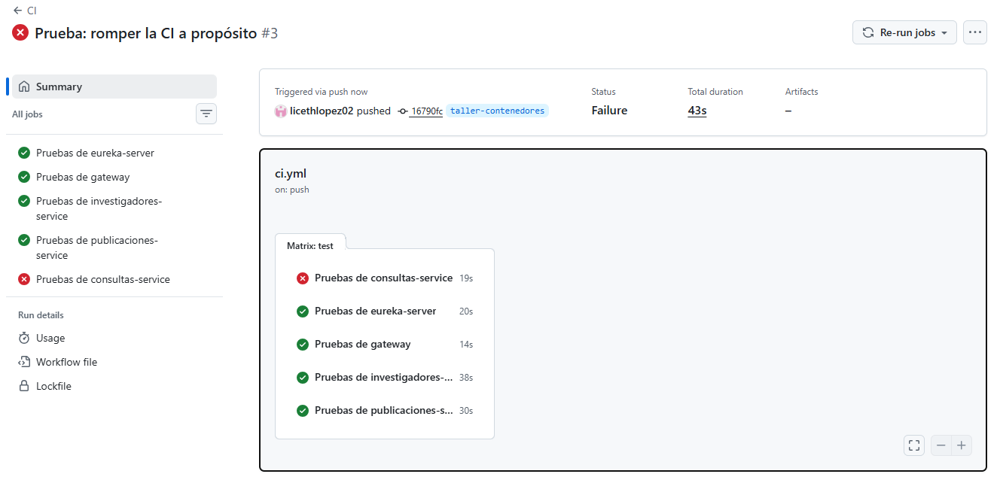

## El Dockerfile multi-etapa

**Respuestas**

(a) Se copia primero `pom.xml` para que Docker pueda guardar en caché la capa
donde descarga las dependencias. Así, si solo cambia el código de `src`, se
reutiliza esa capa y la compilación no tiene que descargar las dependencias de
nuevo.

(b) La imagen final contiene el JRE de Eclipse Temurin 25 y el `.jar` de
Eureka Server, junto con lo necesario para ejecutarlo. No contiene Maven, el
JDK ni el código fuente, porque esos elementos se usan en la etapa de
compilación y no se copian a la etapa final.

(c) `USER rica` hace que la aplicación se ejecute con un usuario sin
privilegios de administrador, en vez de hacerlo como `root`. Esto reduce el
impacto potencial de un problema dentro del contenedor.

### Comprobación de la caché

Modifica algo trivial en `eureka-server/src/main/resources/application.yml`
(por ejemplo, agrega un comentario) y vuelve a construir la imagen. Anota qué
instrucciones se ejecutaron de nuevo y cuáles Docker encontró en caché.

Al cambiar un archivo de `src`, Docker reutiliza las capas de `pom.xml` y de
`mvn dependency:go-offline`, porque el pom no cambió. Vuelve a ejecutar
`COPY src ./src` y `mvn -B -q -DskipTests package`; como el `.jar` resultante
cambia, también vuelve a copiarlo a la imagen final con `COPY --from=build`.
Así se comprueba por qué conviene copiar `pom.xml` antes que `src`.

### Una imagen para todos los entornos

Es mejor construir una sola imagen y usarla en desarrollo, pruebas y
producción, configurando cada entorno por separado, que construir una imagen
distinta para cada uno. Así se promueve exactamente el mismo artefacto entre
entornos: se reducen las diferencias accidentales, los errores de configuración
en la imagen y el riesgo de que algo que funcionó en pruebas falle en
producción. También se construye y valida la imagen una vez, lo que hace el
proceso más reproducible. Los valores propios de cada entorno, como puertos,
direcciones o credenciales, deben proporcionarse mediante configuración
externa, no incorporarse en imágenes diferentes.

## Evidencis CI

